# 🇪🇸 Spanish Mastery

**Learn Spanish through play.** A vocabulary trainer with 1,800 words, step-by-step lessons, five quick games, pronunciation, Polish & English translations, cloud-saved progress and global leaderboards.

**▶ Live app: [spanish-mastery.web.app](https://spanish-mastery.web.app)**


<p align="center">
  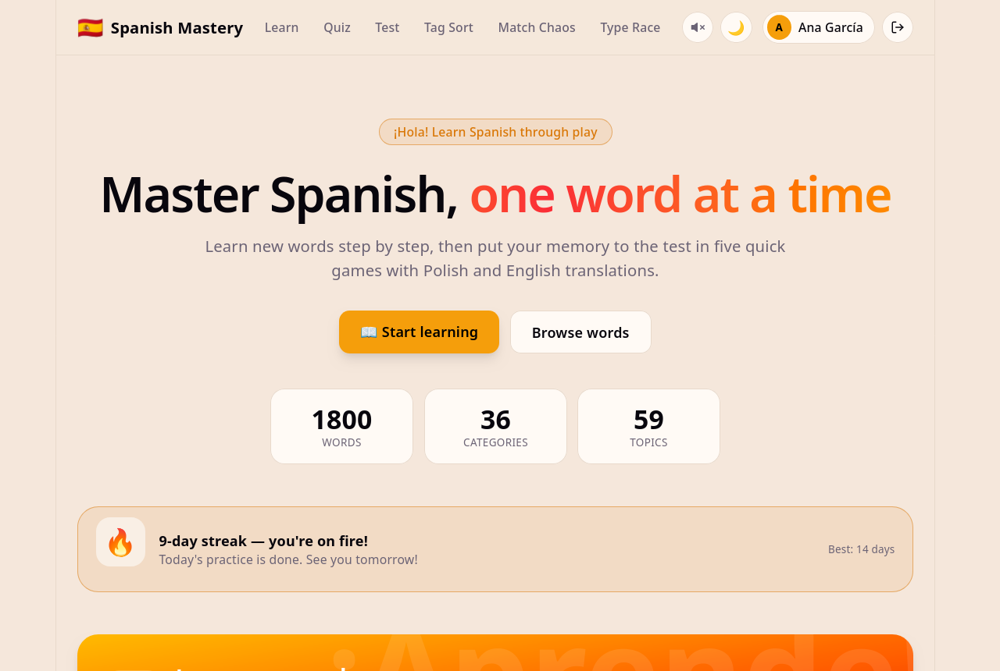
</p>

## Screenshots

> Screenshots show sample data (a demo user and example scores).

### 📖 Learn: step-by-step lessons

| Discover (flashcard) | Flipped card | Recognize |
|---|---|---|
| 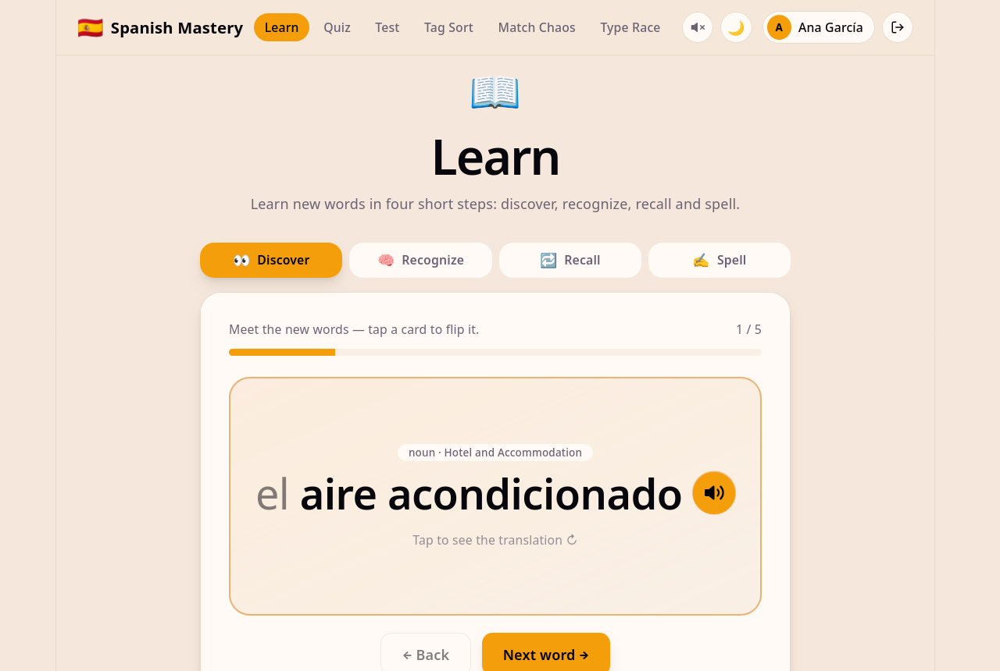 | 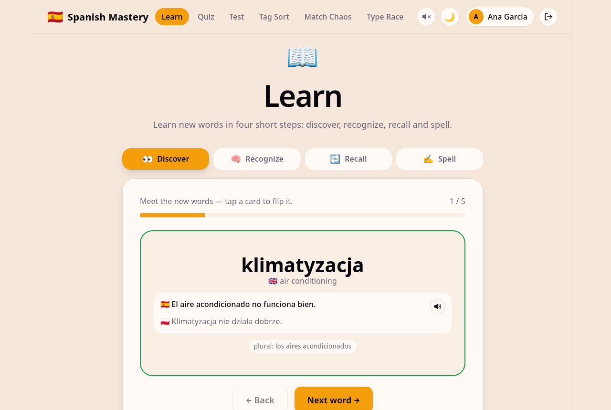 | 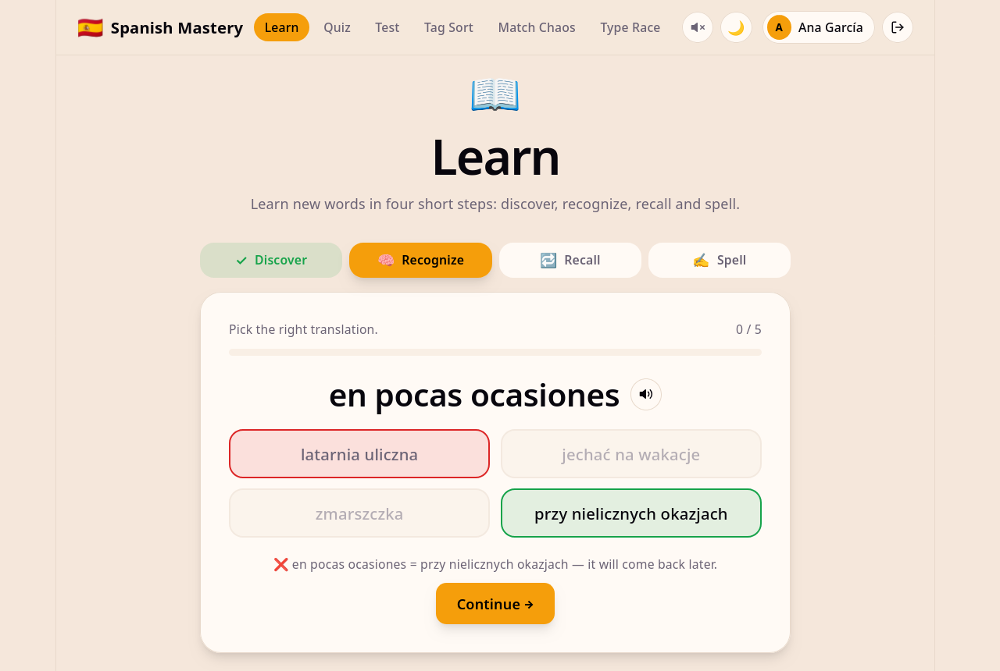 |

### 🎮 Games

| Quiz (dark theme) | Type Race |
|---|---|
| 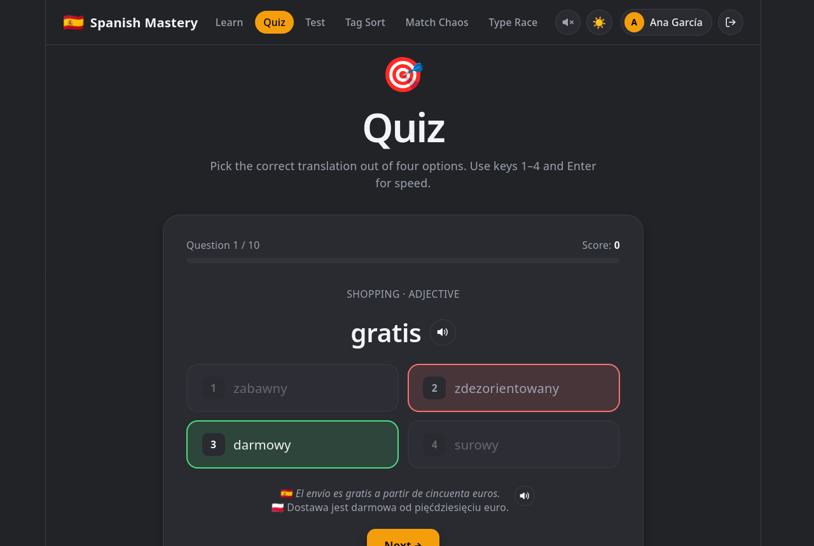 | 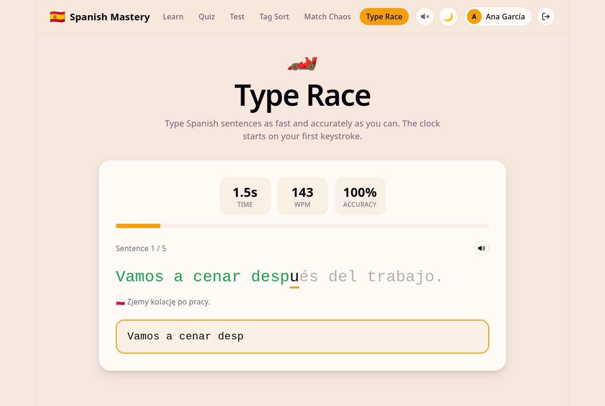 |

### 📊 Profile & leaderboards

| Profile | Top 10 scores |
|---|---|
| 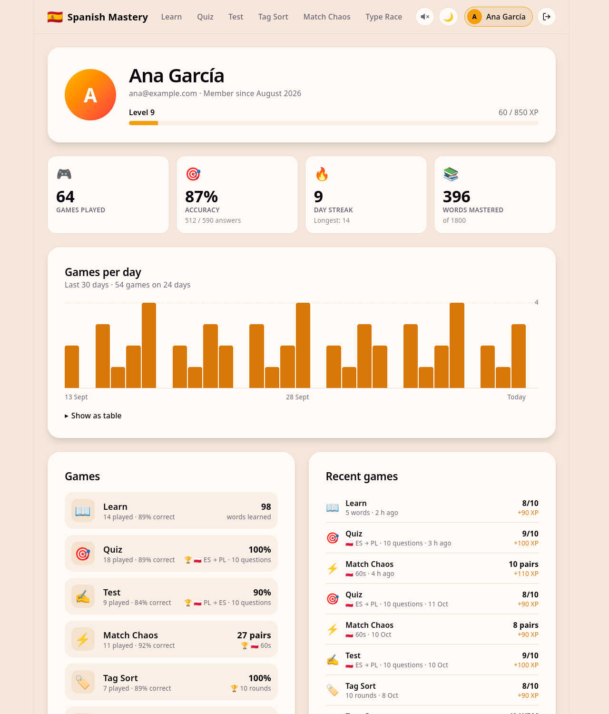 | 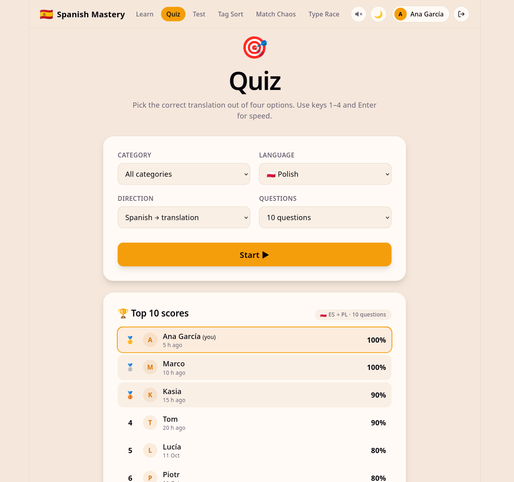 |

### 📱 Mobile

<p align="center">
  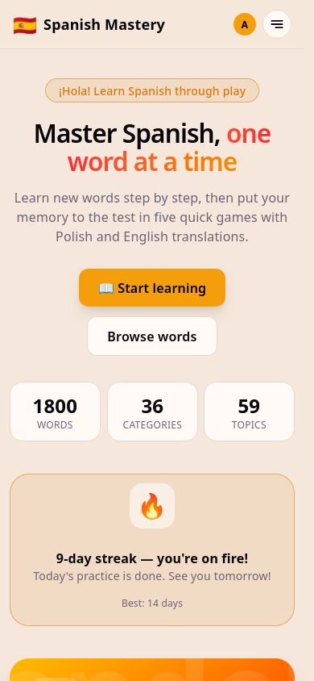
  &nbsp;
  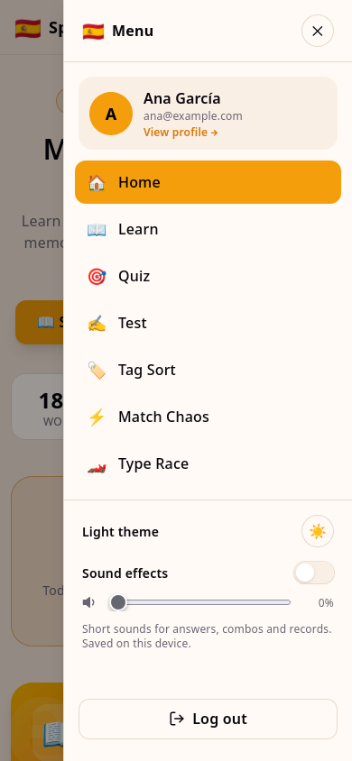
  &nbsp;
  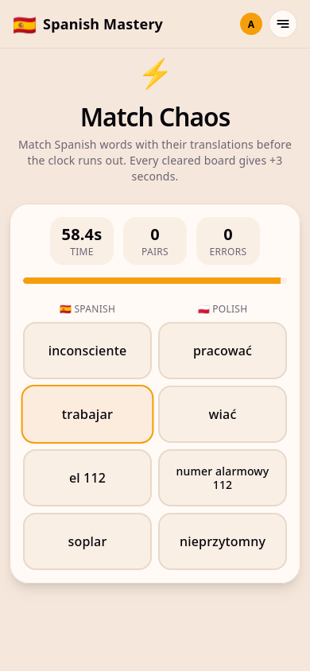
</p>

### 🔐 Sign in

<p align="center">
  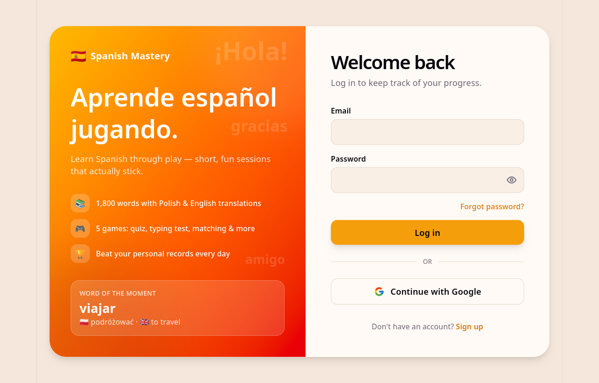
  &nbsp;
  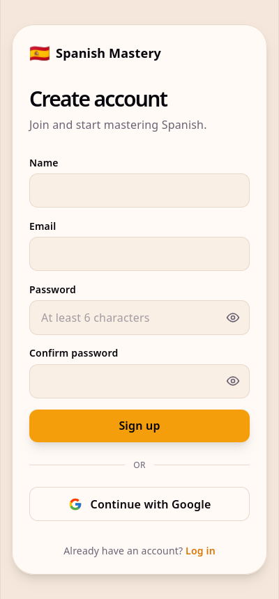
</p>

## Features

- **1,800 words in 36 topics.** From basic communication to travel, health and business. Each word has Polish and English translations, an example sentence in all three languages, and grammar details: article and plural for nouns, present-tense conjugation for verbs, feminine forms for adjectives.
- **Learn mode:** short lessons in four steps (discover, recognize, recall, spell). Words you get wrong come back until you get them right, and new words are picked first.
- **Review from your profile:** the words you miss most often are listed on your profile. Review all of them in one lesson, or pick a single word.
- **Text to speech:** a speaker icon next to words and example sentences reads them aloud in Spanish, Polish or English, using the most natural voice your browser offers.
- **Five games**, each with its own settings (category, language, direction, number of questions).
- **Accounts:** email/password or Google sign-in (Firebase Authentication). The app is available only to signed-in users.
- **Progress saved to your profile:** XP and levels, accuracy, day streaks, personal records and per-word mastery, stored in Cloud Firestore.
- **Profile page** with an activity chart, mastery per category and a list of the words you get wrong most often.
- **Top 10 leaderboard** for every game mode, updated in real time.
- **Sound effects** for answers, combos and records, with a volume control and mute switch.
- **Mobile-first layout:** slide-out menu, game screens that don't jump around, and text that always fits.
- **Smooth animations:** page transitions, flip cards, staggered lists and confetti for records. They're turned off automatically when the system asks for reduced motion.
- **Searchable dictionary** and a light/dark theme.

### Modes

| Mode | How it works |
|---|---|
| 📖 **Learn** | Discover new words on flashcards, then recognize, recall and spell them. |
| 🎯 **Quiz** | Pick the correct translation out of four options (keys 1–4 + Enter). |
| ✍️ **Test** | Type the translation yourself. A missing accent still counts, with a hint. |
| ⚡ **Match Chaos** | Match Spanish words with their translations against the clock. Every cleared board adds +3 s. |
| 🏷️ **Tag Sort** | A topic appears; find the one word that belongs to it. |
| 🏎️ **Type Race** | Type Spanish sentences as fast as you can. Shows WPM and accuracy. |

## Tech stack

- **Frontend:** React 19, TypeScript, React Router, Tailwind CSS 4, Vite
- **Backend:** Firebase Authentication, Cloud Firestore (with offline cache), Firebase Hosting
- **Sound:** Web Audio API. All effects are synthesized in the browser, so there are no audio files.
- **Speech:** Web Speech API (`speechSynthesis`) with automatic voice selection. The app prefers neural/online voices: Edge "Natural", Chrome "Google", Safari "Siri/Enhanced".

## Getting started

Requirements: Node.js 20+ and a Firebase project with **Authentication** (Email/Password, optionally Google) and **Cloud Firestore** enabled.

```bash
git clone https://github.com/Tomasz1907/spanish-mastery.git
cd spanish-mastery
npm install

cp .env.example .env.local   # fill in your Firebase web app config
npm run dev                  # http://localhost:5173
```

The values for `.env.local` are in the Firebase Console under **Project settings → Your apps → Web app → SDK setup and configuration**.

### Scripts

| Command | Description |
|---|---|
| `npm run dev` | Start the development server |
| `npm run build` | Type-check and build to `dist/` |
| `npm run lint` | Run ESLint |
| `npm run preview` | Preview the production build |
| `npm run deploy` | Build and deploy to Firebase |

### Deploying to Firebase

```bash
npx firebase login
npx firebase use <your-project-id>
npx firebase deploy --only firestore   # security rules + leaderboard index
npm run deploy                         # build + hosting
```

## Project structure

```
public/data/data.json     vocabulary (36 categories × 50 words)
src/
  pages/                  Home, Learn, Profile, Login, Register and the five games
  components/             UI building blocks (GameUI, Leaderboard, SoundControl, …)
  context/                authentication state (useAuth)
  lib/
    vocab.ts              loading words, answer checking, helpers
    progress.ts           saving results, profile, leaderboards (Firestore)
    sound.ts              synthesized sound effects and volume settings
    speech.ts             text to speech with natural voice selection
    firebase.ts           Firebase initialization
firestore.rules           Firestore security rules
firestore.indexes.json    Firestore indexes
```

## Data

### Vocabulary entry

```json
{
  "id": "travel_002",
  "word": "la excursión",
  "translation_pl": "wycieczka",
  "translation_en": "excursion / day trip",
  "part_of_speech": "noun",
  "tags": ["travel"],
  "article": "la",
  "gender": "feminine",
  "plural": "las excursiones",
  "example_es": "Mañana hacemos una excursión a Toledo.",
  "example_pl": "Jutro jedziemy na wycieczkę do Toledo.",
  "example_en": "Tomorrow we're going on a day trip to Toledo."
}
```

Verbs also include `conjugation` (present tense), `gerund`, `participle` and `regular`. Adjectives include `masculine_form` and `feminine_form`.

### Firestore

| Path | Contents | Access |
|---|---|---|
| `users/{uid}` | stats, XP, streaks, personal records | owner only |
| `users/{uid}/results/{id}` | history of played games | owner only |
| `users/{uid}/progress/words` | correct / wrong count per word | owner only |
| `leaderboards/{game:mode}/scores/{id}` | name, avatar and score | read: signed-in users · create: own scores only |

Leaderboard entries store only a display name, avatar and score. Email addresses are never shown publicly.
